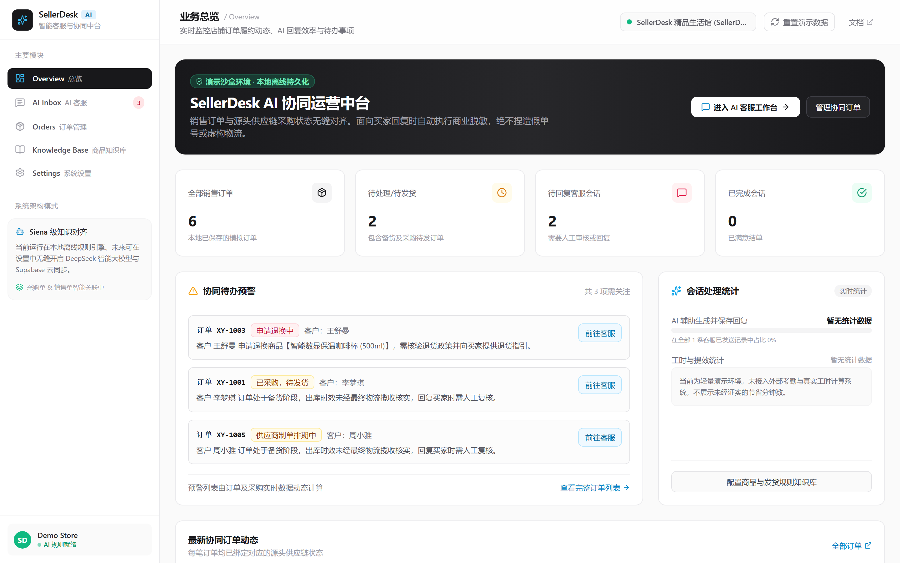
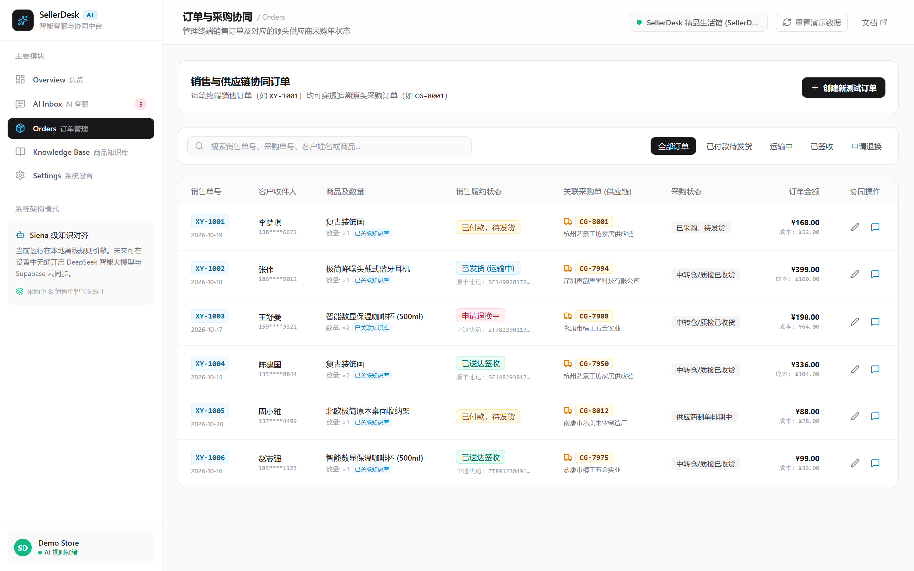
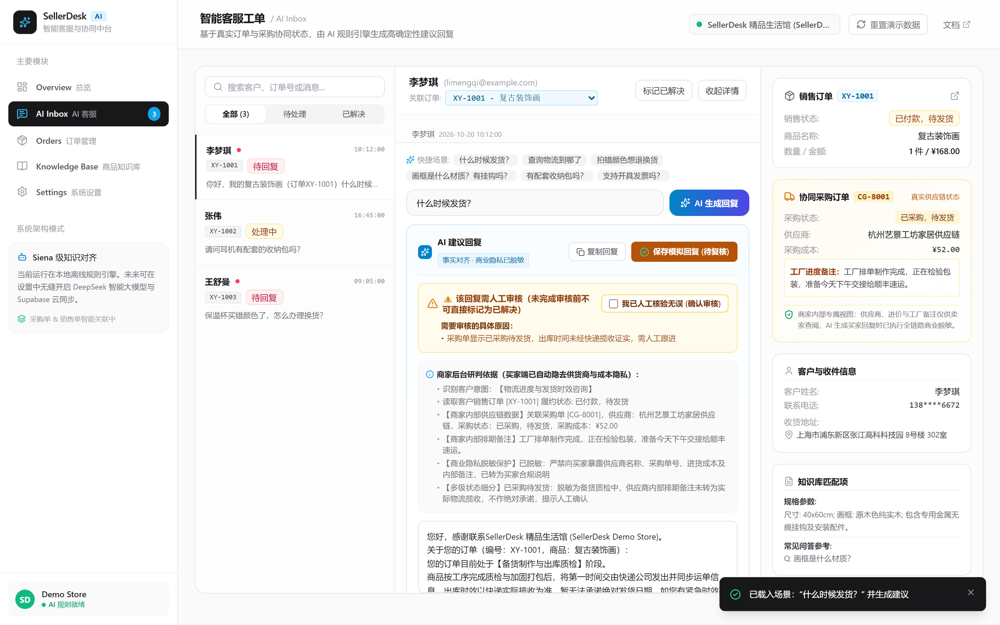
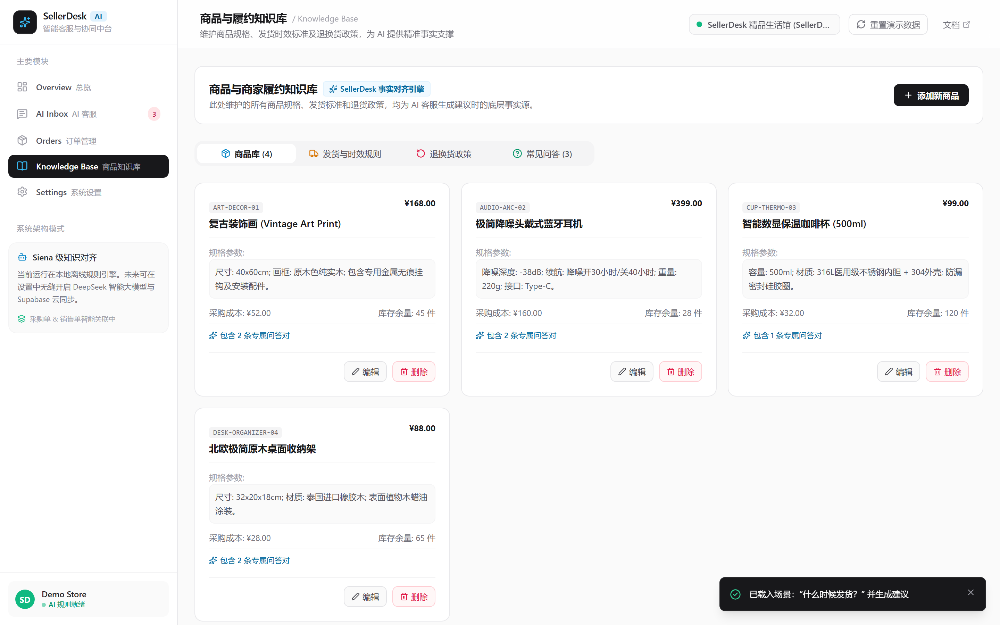
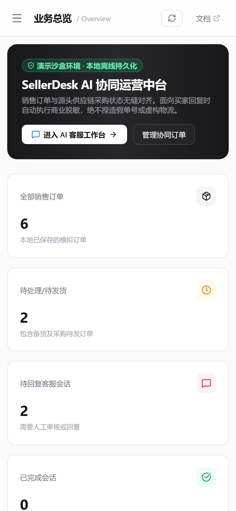
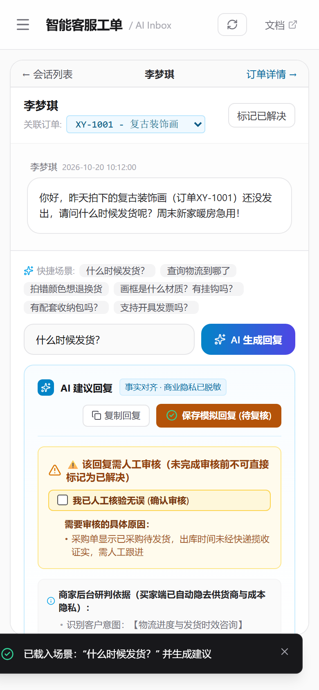
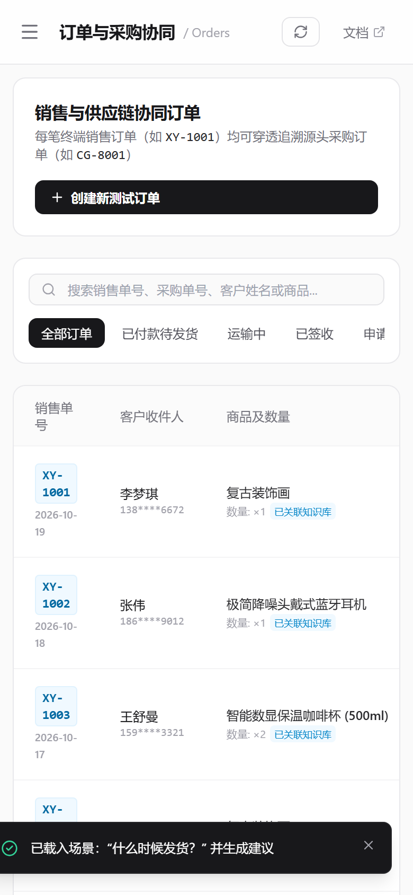
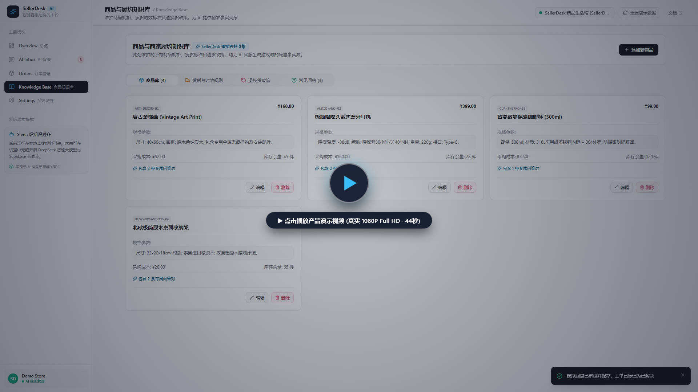

<div align="center">

# SellerDesk AI

**Lightweight E-commerce AI Copilot & Supply Chain Order Management Workstation**  
*独立自研的轻量级电商智能客服与协同中台 · 真实订单研判 · 供应链隐私保护 · 事实对齐*

[](https://yaohaoliang141-max.github.io/sellerdesk-ai/)
[](LICENSE)
[](tests/)
[](https://api.deepseek.com)
[](https://react.dev/)
[](https://www.typescriptlang.org/)
[](https://tailwindcss.com/)
[](https://vitejs.dev/)

[🚀 访问线上体验版 (无需安装，即开即用)](https://yaohaoliang141-max.github.io/sellerdesk-ai/) · [📺 观看 1080P 演示视频](#-完整产品演示视频) · [🛠 本地运行构建](#-本地部署与开发)

</div>

---

## 📌 产品定位

**SellerDesk AI** 是一个独立设计与开发的**轻量级电商 AI 客服与订单协同中台**，内置确定性事实研判引擎与双向商业风控机制。

面向轻资产电商、无货源一件代发、跨境独立站与二手电商（闲鱼/转转）卖家，打通**“终端销售订单”**与**“源头采购订单（1688/供货工厂）”**之间的信息断层。系统依托真实订单状态与商家履约政策库生成回复建议，严格防范商业机密泄露与无依据承诺，通过**“事实研判建议 + 人工核验把关”**的闭环，保障每一次买家沟通的准确与专业。

---

## 🖥 首页总览 Dashboard

采用类似 Linear 与 Notion 的专业极简管理后台设计，所有指标与异常预警均从当前订单及会话数据实时动态计算：



---

## ⚡ 核心协同流程演示 (GIF)

从销售订单创建、选择知识库商品与关联采购单，到直达 AI 客服工作台、提取事实研判、触发人工审核预警并保存记录：


> **流程详解**：
> 1. **订单创建与穿透**：录入销售订单并关联 1688 采购单，记录供应商名称、采购状态与进货成本。
> 2. **工单无缝直达**：点击“前往客服”直接定位对应订单的专属会话，若无买家历史留言则自动初始化纯净工单，**绝不捏造买家咨询**。
> 3. **事实研判与隐私保护**：输入客户提问，系统检索真实物流与采购节点。买家回复自动隐去供应商名称与成本，同时在商家后台展示研判推理依据。
> 4. **强制人工审核**：存在未录入单号或供应链排单等待时，高亮提示“⚠️ 需要人工审核”并锁定直接标记为已解决，必须由商家核对勾选后方可保存。

---

## 📸 核心功能界面与设计规范

### 1. 销售与供应链协同订单管理 (Orders)

真实呈现终端销售与源头采购的对应关系，支持按订单状态筛选与跨表字段检索：



* **多级状态细分**：区分供应商制单排期、工厂出库中转、质检仓收货、快递承运配送与签收等多级状态。
* **商品动态联动**：从知识库下拉选品，自动同步售价、成本与规格；支持录入非库商品且不绑定错误商品属性。
* **防重校验机制**：销售单号唯一性校验，防止重复录入。

---

### 2. AI 客服工作台与人工审核把关 (AI Inbox)

集工单列表、客户会话流、研判推理链、双引擎模式切换与审核提示于一体的一站式客服中台：



* **双引擎模式随心切换**：
  * **模拟规则引擎 (默认)**：基于确定性领域规则与商家知识库快速推断，零外部依赖，安全高效。
  * **真实 DeepSeek 模型**：通过本地服务端代理安全直连 DeepSeek 官方 API (`deepseek-chat` / `deepseek-flash`)，结合订单履约事实生成自然语言回复。
* **双层商业隐私脱敏**：前端调用前与代理服务器转发前双重过滤，严禁向大模型发送供应商名称、1688 采购单号、成本底价与商家备忘。
* **生成结果独立安全审查**：大模型生成回复后，系统进行后置安全扫描。一旦检测到未证实的物流时效承诺、未经核验的退款退货承诺或机密数据，自动警示并回退安全话术，标为需人工审核。
* **专业桌面排版**：三栏宽度经过精细比例重构，操作按钮均采用单行防挤压排列，在标准 1440px 视口下清晰流畅。
* **事实推理链公开**：展示 AI 提取的数据来源（采购状态、全店政策、商品规格），辅助商家决策。
* **审核拦截机制**：当出现缺少单号、时效未核实或政策存疑时，强制显示审核原因并要求人工核验确认。
* **安全模拟保存**：仅提供“保存模拟回复”与“复制回复”，不连接真实买家接口，杜绝静默误发。

---

### 3. 双层履约知识库 (Knowledge Base)

商品基础资料与全店规则中心，作为客服回复建议的底层事实源泉：



* **商品专属知识**：维护 SKU、售价、成本、材质规格与专属常见问答。
* **全店通用政策**：集中维护发货时效标准（如 48 小时质检发出）、7 天退换货规则与全店通用 FAQ（如包邮范围、发票开具）。
* **即时更新生效**：商家维护政策或问答后，AI 工作台新生成的建议即刻使用最新依据。

---

### 4. 移动端全响应式适配 (Mobile View)

精心优化的移动端抽屉导航与多视图无缝切换，杜绝横向溢出，随时随地在手机或平板上处理工作：

<div align="center">
  <table>
    <tr>
      <td align="center" width="33%">
        <br />
        <sub><b>📱 移动端总览仪表盘</b></sub>
      </td>
      <td align="center" width="33%">
        <br />
        <sub><b>💬 移动端智能客服工作台</b></sub>
      </td>
      <td align="center" width="33%">
        <br />
        <sub><b>📦 移动端订单与采购协同</b></sub>
      </td>
    </tr>
  </table>
</div>

---

## 📺 完整产品演示视频

点击下方视频封面即可观看**真实 1080P Full HD（1920×1080，44 秒）**高清演示视频（H.264 编码，无黑边全景录屏，真实展示 Dashboard、订单协同、AI 客服研判与人工审核拦截）：

[](docs/media/demo.mp4)

> 💡 *若在部分移动端浏览器中无法直接点击播放，可在仓库 [`docs/media/demo.mp4`](docs/media/demo.mp4) 中直接下载或预览原画质文件。*

---

## 🎯 业务与安全设计原则

1. **商业隐私安全第一**
   - 采购成本、供应商店铺名、1688 采购单号、工厂内部备忘属于卖家核心商业机密。
   - 面向买家的文本绝对脱敏，仅在卖家后台管理区显示。
2. **拒绝捏造事实与时效承诺**
   - 采购订单“已发货”不等于买家订单“已发货”，在终端运单号未生成前绝不虚报快递公司与单号。
   - 知识库未收录或时效未经核实的问题，明确提示“需人工核实”，绝不胡编乱造。
3. **前端零私密 Key 暴露与本地代理架构**
   - 前端网页不提供任何大模型 API Key 输入框或客户端本地保存，避免密钥泄露。
   - 接入大模型时采用本地轻量代理服务端 (`server/index.js`)，仅从本地环境变量 `.env` 读取密钥并监听 `127.0.0.1`，绝不在公开网页中暴露。
4. **演示环境与真实边界透明披露**
   - 页面明确标注演示环境，所有概览统计均从内存与 localStorage 真实计算，剔除虚假效率指标与假采纳率。
   - GitHub Pages 线上预览版默认采用纯客户端规则模拟与优雅降级；本地运行 `npm run dev:ai` 即可体验真实 DeepSeek 大模型交互。

---

## ⚠️ 当前版本能力与边界声明

为避免误导使用者与潜在合作伙伴，特此如实披露当前技术版本（v0.1.0）的具体实现边界：

| 模块 | 当前实现方式 | 生产版规划 (Roadmap) |
| :--- | :--- | :--- |
| **客服推理引擎** | 双引擎无缝切换：① 离线确定性事实规则引擎；② 本地安全代理直连 DeepSeek 官方大模型 (`deepseek-chat` / `deepseek-flash`)，支持多轮上下文与双向隐私脱敏 | 接入生产级云端后端代理与意图向量检索 (RAG) |
| **数据持久化** | 浏览器 `localStorage` 离线存储，支持一键重置 | 接入 Supabase / PostgreSQL 云端数据库与权限管理 |
| **电商平台对接** | 纯前端模拟工单与测试订单录入 | 通过 Open API 或授权插件对接闲鱼、淘宝、Shopify |
| **采购平台协同** | 模拟录入 1688 采购单号、状态及成本 | 通过开放平台或商家授权同步 1688 供货与物流状态 |
| **消息发送模式** | 商家核验后“复制回复”或“保存模拟回复” | 经商家授权后推送回复至对应的客服渠道 |

---

## 🛠 本地部署与开发

无需配置复杂后端环境或数据库，只需 Node.js 即可极速启动：

### 1. 环境准备
- Node.js (推荐 v18.0 或更高版本，已在 Node.js v24.14.0 完整验证)
- npm / pnpm / yarn

### 2. 克隆与依赖安装

```bash
# 克隆仓库
git clone https://github.com/yaohaoliang141-max/sellerdesk-ai.git
cd sellerdesk-ai

# 安装依赖
npm install

# 运行自动化真实性、工作流与 DeepSeek 代理测试 (20 项测试全通过)
npm test
```

### 3. 启动运行模式

#### 模式 A：纯前端极速开发（默认规则模拟模式，无需任何配置）

```bash
npm run dev
```

在浏览器打开终端输出的本地地址（如 `http://localhost:5173/`），可立即体验完整的订单协同、双层知识库与规则推理工作台。

#### 模式 B：接入真实 DeepSeek 大语言模型

系统内置专为本地开发设计的极简 Node.js 安全代理服务，确保 API Key 不泄漏：

```bash
# 1. 复制环境变量配置文件
cp .env.example .env

# 2. 编辑 .env 文件，填入你的 DeepSeek API Key (如 DEEPSEEK_API_KEY=sk-xxxx)
# 注：.env 已被 .gitignore 忽略，绝不会被意外提交到 GitHub

# 3. 一键启动代理服务与前端开发环境
npm run dev:ai
```

启动后：
1. 本地代理服务将在 `127.0.0.1:3001` 启动并安全校验 DeepSeek 连接。
2. 前端客服工作台（AI Inbox）顶部状态灯将显示为 **“DeepSeek 本地服务在线”**。
3. 点击 **“真实 DeepSeek 模型”** 即可在保留人工审核与脱敏机制的前提下，由真实大模型生成自然客服对话！

### 4. 构建与部署

```bash
# 类型检查与打包
npm run build

# 自动重新生成全量产品截图、GIF 动图与演示视频 (需本地 Playwright 与 ffmpeg)
# 执行前会自动执行 build 校验，构建失败则立即中止
npm run generate-media

# 一键部署到 GitHub Pages (gh-pages 分支)
npm run deploy
```

---

## 🧪 自动化测试套件

项目内置针对商业隐私、物流真实性、知识库全店检索、完整业务协同以及 DeepSeek 安全代理的自动化测试套件：

```text
▶ AIEngineService - 商业隐私、真实性与知识库检索测试
  ✔ 商业隐私保护：买家可见回复绝不泄露供应商名称、采购单号、采购成本与工厂内部备注
  ✔ 知识库全店 FAQ 检索：能够检索全店 FAQ 知识并精准回答开票与质保问题
  ✔ 多级状态细分：供应商已出库但终端未录入运单号时，说明中转揽收中并触发人工审核
  ✔ 缺失物流信息：订单标记为已发货但无运单号，触发人工审核与原因说明
  ✔ 售后场景隐私保护：退换货咨询中严禁暴露关联采购单信息或供货成本
  ✔ 物流测试：已发货订单只提供已有单号与承运商，不编造预计送达时间
  ✔ 商品问答测试：精准命中专属知识库规格与问答
  ✔ 商品问答测试：知识库未收录的问题明确提示需人工核实，拒绝胡编乱造

▶ SellerDesk AI - 完整业务协同工作流测试
  ✔ 1. 新建不同商品订单：确认选择知识库商品与自定义商品时，productId 关联准确，严禁死锁 prod-001
  ✔ 2. 订单直达客服工作台：点击前往客服时，若无会话则自动创建纯净空白工单，绝不虚构买家留言
  ✔ 3. 修改订单状态后，客服生成回复依据实时同步变化
  ✔ 4. 知识库 FAQ 修改后，重新生成的回复立即使用最新维护的条目
  ✔ 5. 动态总览数据统计：真实从当前订单与会话计算，无死锁硬编码
  ✔ 6. 本地持久化储存读写校验：修改订单与保存客服回复后，StorageService 正确持久化

▶ DeepSeek 本地服务与大模型协同安全测试
  ✔ 1. 个人隐私脱敏：买家电话、邮箱、身份证与详细地址在服务端严格脱敏打码
  ✔ 2. 字段白名单与采购阶段转换：阻断供应商/单号/底价，仅向模型提供脱敏履约阶段
  ✔ 3. 测试阶段全量人工把关与未核实事实拦截：任何 AI 建议均需人工核验
  ✔ 4. 本地代理 HTTP 严格安全防御：阻止非法 Origin、Host、Referer 与非 JSON 请求
  ✔ 5. 错误模型配置清晰报错与离线降级验证
  ✔ 6. 异步串单防护逻辑验证：切换会话或订单后安全忽略过期回复

ℹ tests 20 | suites 3 | pass 20 | fail 0
```

---

## 🗺 技术演进路线 (Roadmap)

- [x] **v0.1.0 基础协同版 (当前版本)**
  - [x] 销售订单与 1688 采购订单多级关联
  - [x] 基于真实事实与履约规则的 AI 客服研判
  - [x] 本地 Node.js 安全代理接入 DeepSeek 官方大模型（双向脱敏与安全质检）
  - [x] 供应链核心商业隐私自动脱敏
  - [x] 强制人工审核拦截与核验标记
  - [x] 双层知识库与动态指标 Dashboard
  - [x] 纯前端无服务架构与自动化测试套件 (20 项全通过)
  - [x] 基于真实事实与履约规则的 AI 客服研判
  - [x] 供应链核心商业隐私自动脱敏
  - [x] 强制人工审核拦截与核验标记
  - [x] 双层知识库与动态指标 Dashboard
  - [x] 纯前端无服务架构与自动化测试套件
- [ ] **v0.2.0 云端协作版**
  - [ ] 接入 Supabase / PostgreSQL 实现多客服账号与跨设备实时同步
  - [ ] 接入 DeepSeek-V3 / DeepSeek-R1 模型后端代理（服务端安全签名）
  - [ ] 支持订单与商品知识库的 CSV / Excel 批量导入导出
- [ ] **v0.3.0 平台直连版**
  - [ ] Chrome 浏览器扩展插件，一键注入闲鱼 / 淘宝千牛客服侧边栏
  - [ ] 1688 采购订单物流状态通过开放平台或商家授权回传同步
  - [ ] 多店铺、多币种与多语言跨国支持

---

## 📄 开源许可证

本项目基于 [MIT 许可证](LICENSE) 开源。欢迎 Star、Fork 与提出 Issue 交流！
